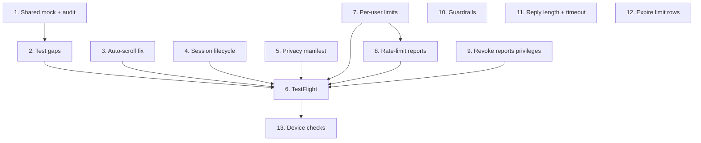

# Implementation Plan — Astrology Chat (Week 10: Tests, Privacy & TestFlight)

## Overview

Goal by Friday: the ViewModel is unit-tested and the privacy manifest is in
place. No App Store submission. A TestFlight build is optional.

Week 9 left the app polished and accessible: typing indicator, haptics, glass
bars, plain-text replies, truncated-reply errors, reporting, VoiceOver
announcements and Dynamic Type fixes. Open device checks and bugs found along
the way are in `tech-debts.md`.

Two things from Week 9 shape this week:

- **Much of the test work already exists.** Weeks 5–6 landed stub services and
  ViewModel tests for optimistic append, streaming accumulation, error surfacing
  and state cleanup (`ChatViewModelTests`, `ChatViewModelStreamingTests`,
  `ChatViewErrorTests`), so the three test sessions are compressed into Tasks
  1–2. 429 handling and a single shared mock look like the real gaps.
- **A "new" chat after relaunch isn't a new session.** The session id lives in
  the Keychain forever, while messages are in memory only, so the backend's turn
  count carries over into a chat that looks fresh. Task 4 fixes it, and Task 3
  fixes auto-scroll, found in the same check.

## Tasks

### Mon — shared mock service

- [x] 1. Audit the test doubles and build one shared mock
  - Audit the existing test doubles and ViewModel tests.
  - Build one mock conforming to `ChatServiceProtocol` that simulates success,
    errors, 429, and streamed tokens. Replace the per-file stubs where it fits.
  - _Done when: the mock can drive the ViewModel without the network._

### Tue — ViewModel test gaps

- [x] 2. Fill the ViewModel test gaps
  - Fill only what Task 1's audit found missing. Expected: 429 handling and
    friendly messaging. Optimistic append, streaming accumulation, error
    surfacing and state cleanup are already covered.
  - _Done when: the gaps are tested and the target is green._

### Wed — bug fixes from Week 9

- [x] 3. Fix auto-scroll
  - The transcript doesn't follow a new reply or the typing indicator. Start
    with `ChatView.scroll(to:from:using:)` and the `onChange(of: ScrollAnchor…)`
    wiring.
  - _Done when: a new reply and the typing indicator scroll into view on the
    simulator._

- [x] 4. Start a new session on launch and on "Start new conversation"
  - Mint a new session id on each launch, so the turn count starts fresh with
    the empty transcript. `SessionManager.sessionID` stops reading the Keychain
    id back (rate-limit scoping moves with it).
  - "Start new conversation" clears the transcript as well as minting a new id.
    Update `ChatViewModel.startNewConversation()` and its tests.
  - _Done when: a relaunch and the reset button both start at turn 1 with an
    empty transcript, confirmed against `chat_turn_counts`._

### Thu — privacy manifest

- [x] 5. Add the privacy manifest
  - Add `PrivacyInfo.xcprivacy` with accurate data-use declarations.
  - _Done when: the manifest is included._

### Fri — TestFlight (optional)

- [ ] 6. Upload a TestFlight build
  - Archive and validate the build.
  - Upload to TestFlight for internal testing.
  - _Done when: the build installs from TestFlight. Skip if there's no
    TestFlight release._

### Added — security risks

Found in a review on 2026-10-03. None of them are exposed secrets: the only key
in the repo is the publishable key, which is meant to ship in the app.

- [x] 7. Rate-limit and turn-limit by user, not by session
  - Both caps are keyed on the client-chosen `sessionId`, so a new id per
    request skips them and one token can drain the Gemini quota. Since Task 4
    the app mints a new id on every launch too.
  - Add a per-user ceiling keyed on the token's user id (`authResult.userId`)
    on top of, or instead of, the per-session caps. Keep the turn cap per
    session so "Start new conversation" still works.
  - _Done when: a test shows a new `sessionId` on every request still hits the
    per-user limit, and it's verified against production._

- [x] 8. Rate-limit reports
  - `action: "report"` is routed before the limit checks, so one token can
    insert unlimited rows of up to 64 KB into `reports`.
  - Put reports behind a per-user limit too (Task 7's, or a smaller one of
    their own).
  - _Done when: a test shows reports past the limit get a 429 and store
    nothing._

- [x] 9. Revoke client-role privileges on `reports`
  - `anon` and `authenticated` still hold `TRUNCATE` (and `TRIGGER`,
    `REFERENCES`) on `reports`. Add a migration with
    `REVOKE ALL ON TABLE public.reports FROM PUBLIC, anon, authenticated;`,
    matching `20260929000000_create_chat_limits.sql`.
  - _Done when: `information_schema.role_table_grants` shows only `postgres`
    and `service_role`, and a report still stores._

### Added — open tech debts

From `tech-debts.md`. Items that only apply once a feature exists (conversation
history, birth-data tables) stay there.

- [x] 10. Enforce the guardrails in code
  - Set Gemini `safetySettings` explicitly; no category at `BLOCK_NONE`.
  - Reject known jailbreak framing ("ignore previous instructions", "you are
    now", "write a story where").
  - Log refusals and safety blocks (`finishReason: SAFETY`) with the session
    and user id.
  - Decide on the topical gate (a second Gemini call that checks the question
    is about Vedic astrology). It doubles calls per message, so it's a
    decision before it's code.
  - _Done when: safety settings and the denylist are in `handler.ts` with
    tests, refusals are logged, and the gate decision is recorded._

- [x] 11. Decide reply length and the Gemini timeout
  - Readings run 2,600–5,000 characters with nothing shaping them.
    `maxOutputTokens` is at the model limit (Week 9 Task 8), so it's a safety
    net, not a length policy. Options: length guidance in `systemPrompt.ts`
    (needs sign-off, it's product content), a lower ceiling, or "read more" in
    the UI.
  - Check the 45s timeout against real long readings.
  - _Done when: the policy is chosen and in place, and `tech-debts.md` records
    the timeout decision._

- [x] 12. Expire old rows in the limit tables
  - `chat_rate_limits` and `chat_turn_counts` never shrink, and since Task 4
    they gain a row per launch. Add a periodic delete (pg_cron) of rows not
    updated for a set time.
  - _Done when: the job is scheduled in production and old rows are gone._

- [-] 13. Run the device checks
  - Haptics: send tap, success and error patterns feel distinct.
  - VoiceOver: announcements, no re-reading while streaming, stripped
    markdown, "Report Message" in the Actions rotor.
  - Report menu preview at the largest text size.
  - Full lists are in `tech-debts.md`. Needs a device, so it depends on
    Task 6's TestFlight build.
  - _Done when: each check is done by a person and ticked in
    `tech-debts.md`._

## Task Dependency Graph



```json
{
  "waves": [
    { "wave": 1, "tasks": ["1", "3", "4", "5", "7", "9", "10", "11", "12"] },
    { "wave": 2, "tasks": ["2", "8"] },
    { "wave": 3, "tasks": ["6"] },
    { "wave": 4, "tasks": ["13"] }
  ]
}
```

## Notes

- Task 4 made the session id per launch, which is part of why Task 7 matters:
  a relaunch now resets the per-session caps.
- Tasks 7–9 come before any TestFlight build (Task 6) that reaches people
  outside the team.
- Carried forward: re-verify a done-condition independently before trusting the
  checkbox.
- Week 9's history is in git (`2286366` is the last Week 9 version of this
  file).
