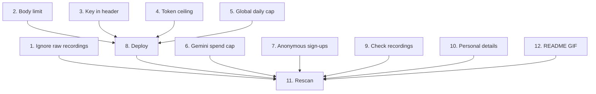

# Implementation Plan — Open-Source Hardening

## Overview

Goal: the repo can go public without leaking anything and without making the
backend cheap to abuse.

A scan on 2026-10-12 found no secrets in the working tree or in any of the 133
commits. The Gemini and service-role keys are only read from function secrets,
and the publishable key is meant to ship. What it did find:

- `docs/media/raw/` (portfolio-only recordings, one of them 1.9 GB) isn't
  ignored. GitHub rejects files over 100 MB, so a push would fail.
- Once the code is public, anyone can see how to call the backend. Anonymous
  sign-in plus a per-user rate limit means a script can mint users and get a
  fresh 20 requests a minute each, and every request can ask for 65,536 output
  tokens. Nothing caps total Gemini spend.
- Two smaller server issues: the 64 KB body limit only applies when
  `Content-Length` is sent, and the Gemini key travels in the URL query string.

This spec comes before Portfolio Showcase Task 7 ("Get the repo ready to go
public"), which still owns the licence, the `PRODUCTION_ENDPOINT.md` /
`rate_test*.py` read-through and the decision on the planning folders.

## Tasks

### Repo — Claude

- [x] 1. Move the raw recordings out of the repo
  - Move `docs/media/raw/` (website-only clips) to
    `web-portfolio/assets/astrologie/`. The rest of `docs/media/` stays.
  - _Done when: `docs/media/raw/` is gone from the repo and the clips are in
    `web-portfolio/assets/astrologie/`._

- [ ] 12. Check the README demo GIF
  - `README.md` embeds `docs/media/astrologie-demo.gif`. Confirm the file is
    there, is the clip Pinky wants, and is small enough for GitHub (under
    10 MB keeps the README quick to load).
  - _Done when: the README's GIF path resolves to the chosen file in
    `docs/media/`._

### Server — Claude

- [x] 2. Enforce the body limit on every request
  - `handler.ts` checks `MAX_BODY_BYTES` against `Content-Length` only. A
    chunked request (no header) is read in full. Read the body through a capped
    reader and answer 413 once it passes 64 KB, header or not.
  - Keep the existing `Content-Length` fast path.
  - _Done when: a test sends a chunked body over 64 KB without
    `Content-Length` and gets 413 with `{ error }`, the existing body-size tests
    still pass, and `deno task verify` passes._

- [x] 3. Send the Gemini key in a header
  - Move the key from `&key=…` in the URL to the `x-goog-api-key` request
    header, so no URL that might get logged carries it.
  - _Done when: a test asserts the outbound URL has no `key=` and the header
    holds the key, and `deno task verify` passes._

- [x] 4. Lower the output-token ceiling
  - `GEMINI_MAX_OUTPUT_TOKENS` is the model maximum (65,536) on purpose: thinking
    tokens count against it. Pinky picks the new ceiling first, and whether to
    also cap thinking with `thinkingConfig.thinkingBudget`.
  - Update the constant, its comment, and the test that pins it.
  - _Done when: the request body carries the agreed values, a long reading
    still ends with `[DONE]` in a local or production check, and
    `deno task verify` passes._

- [x] 5. Add a global daily cap on Gemini calls
  - New migration: a one-row-per-day counter with an atomic increment function,
    RLS on, privileges revoked from `PUBLIC`/`anon`/`authenticated`, executable
    by `service_role` only, and old rows expired by the existing daily cron job.
    Same pattern as `20260929000000_create_chat_limits.sql`.
  - `handler.ts`: check it after the per-user rate limit and the turn cap, before
    Gemini. Over the cap → 503 with a friendly message. Store unreachable → 503,
    fail closed like the other limits.
  - Pinky picks the daily number first. Make it configurable through a function
    secret, with a default in code.
  - _Done when: tests cover under the cap, at the cap, and store down;
    `deno task verify` passes; the migration applies cleanly on a local
    `supabase db reset`._ _No Docker here, so verified instead by
    `supabase db push` to production and a reading that passed the cap
    (2026-10-15)._

### Doing — Pinky (Claude guides step by step on "go")

- [x] 6. Cap spend on the Gemini key
  - Not needed: the key is on the free tier with no billing linked, so Google
    stops it at about 20 calls a day and nothing can be billed.
  - Trade-off: that quota is shared by every user. Once it's used up, the app
    answers "Failed to get response from AI service." until the daily reset.
  - If billing is ever turned on: add a budget with email alerts and a per-day
    request quota on the Generative Language API before anything else.
  - _Done when: confirmed the key is free tier (Pinky, 2026-10-14)._

- [x] 7. Slow down anonymous sign-ups
  - Supabase dashboard: lower the anonymous sign-in rate limit (default 30 an
    hour per IP). _Set to 5 (Pinky, 2026-10-14)._
  - Decide whether CAPTCHA on anonymous sign-in or App Attest is worth doing
    now. Either one needs app changes, so if yes, Claude proposes a new task
    here; if not, Claude adds it to `tech-debts.md`. _Not now: added to
    `tech-debts.md`, to revisit before billing is turned on._
  - _Done when: the new limit is saved in the dashboard and the CAPTCHA /
    App Attest decision is recorded._

- [x] 8. Deploy the server changes
  - `supabase db push` for Task 5's migration, then
    `supabase functions deploy chat`. Set the daily-cap secret if it differs
    from the default.
  - Production check: one normal reading streams to `[DONE]`, an oversized
    chunked body gets 413, and the function logs show no `key=` in any URL.
  - _Done when: both commands succeeded and the three checks passed._

- [x] 9. Check the recordings for anything private
  - Watch `docs/media/astrologie-demo.gif` (public in the repo) and the raw
    clips headed for the website. Look for tokens, the Supabase or Google Cloud
    dashboards, notifications, email addresses and other open windows.
  - _Done when: every clip has been watched, and any clip that shows something
    private is re-recorded or cropped._
  - _Checked 2026-10-15 by Claude from frames sampled every 1 s (repo clips)
    and every 2 s (raw clips): simulator screen only, demo status bar (9:41),
    no notifications, dashboards, keys or personal details. Nothing to fix._

- [x] 10. Trim personal details from the docs
  - `CLAUDE.md` gives a personal device detail as the reason device checks
    can't run. Reword or drop that line.
  - The rest of the planning folders (`portfolio-weekly-executables/`, `.kiro/`)
    is Portfolio Showcase Task 7's decision. Not repeated here.
  - _Done when: you've decided on the `CLAUDE.md` line and it's edited or kept
    on purpose._ _Reworded 2026-10-15: the rule stays, the reason is gone._

### Final check — Claude

- [ ] 11. Rescan before going public
  - Rerun the secret scan over the working tree and the full git history
    (Gemini, Supabase, JWT, private-key and token patterns), and list every
    tracked file over 50 MB.
  - _Done when: the scan finds no secrets, no tracked file is over 50 MB, and
    the results are recorded in Notes._

## Task Dependency Graph



```json
{
  "waves": [
    { "wave": 1, "tasks": ["1", "2", "3", "4", "5", "6", "7", "9", "10", "12"] },
    { "wave": 2, "tasks": ["8"] },
    { "wave": 3, "tasks": ["11"] }
  ]
}
```

## Notes

- Scan on 2026-10-12: no Gemini key, service-role key, Supabase access token,
  JWT, private key or password in the tree or in any commit. The only commit
  email is `dev@pinkysalvanera.com`. `supabase/.temp/` and `xcuserdata/` are
  ignored.
- The publishable key in `SupabaseConfig.swift`, `PRODUCTION_ENDPOINT.md` and
  `rate_test*.py` is safe to publish. Access is enforced by the bearer token,
  RLS and the revoked grants.
- Tasks 4 and 5 need a number from Pinky before any code is written.
- Tasks 6–10 are Pinky's. Claude walks through each one when Pinky says "go"
  for it.
