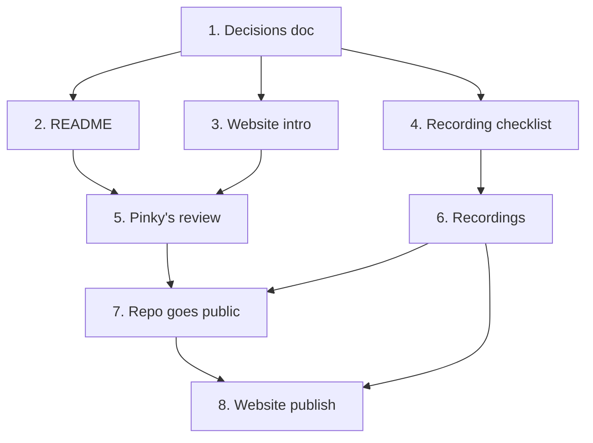

# Implementation Plan — Portfolio Showcase

## Overview

Goal: Astrologie is presentable to a hiring team. Someone can land on
pinkysalvanera.com, read a short intro, watch the app work, open the GitHub repo,
and find the reasoning behind each decision.

It's written for three readers, each with less time than the one after:

- **Recruiter, about 30 seconds:** the website card. An intro, four highlights
  and a screen recording.
- **Hiring manager, 2–5 minutes:** the README. What the app is, an architecture
  diagram, the key decisions in one line each, and how to run and test it.
- **Interviewer or Pinky preparing for one:** `decisions.md`. Every decision,
  why it was made, what was rejected, and how it's likely to come up in an
  interview.

`decisions.md` is the source. The README and the website copy are cut down from
it, so a fact changed there should be changed in both.

This spec is separate from `.kiro/specs/astrology-chat/tasks.md` (the app's
build plan) and doesn't change it. The website's placeholder reads "TODO (T14)";
this spec is the work behind that placeholder.

## Tasks

### Writing — Claude

- [x] 1. Write the decisions doc
  - `portfolio-weekly-executables/decisions.md`: every decision in the project
    (product, architecture, platform, streaming, AI and backend, safety and
    cost, UI, process), each with what was decided, why, what was rejected, and
    how it's likely to come up in an interview.
  - Include Pinky's own notes on why the app exists, reworded where they were
    inaccurate and kept gender-neutral.
  - _Done when: every factual claim matches the code or a planning doc, and
    the corrections found in review are in (iOS 18 target, Liquid Glass on
    iOS 26, no search grounding, "foundation models", Vertex AI as a platform)._

- [x] 2. Write the README
  - Replace the two-line `README.md`: what it is, a demo placeholder,
    highlights, a Mermaid architecture diagram, key decisions, tech stack,
    project layout, how to run and test, how it was built, what's next.
  - _Done when: the README has every section above, the test counts come from a
    real run, and the demo slot is marked for Task 6._

- [x] 3. Write the website intro
  - `portfolio-weekly-executables/website-intro.md`: an intro paragraph and four
    highlight cards in the same format as the GlobeOne cards (title and one or
    two sentences), plus a link line and a short alternative intro.
  - _Done when: the copy fits the site's existing tone and every claim is
    backed by `decisions.md`._

- [x] 4. Write the screen-recording checklist
  - `portfolio-weekly-executables/screen-recordings.md`: a self-contained brief
    another session can follow without this one. The list of clips, what each
    shows, how to stage it (live app or Xcode preview), capture and export
    settings, and the Gemini quota budget.
  - _Done when: each clip says where it's used (website, README, or both), how
    to set it up, and how many Gemini calls it costs._

### Doing — Pinky

- [ ] 5. Review and adjust the writing
  - Read `decisions.md` first, then the README and the website copy. Fix
    anything that doesn't sound like you. The interview notes are prep for you,
    so decide whether `decisions.md` goes public as is, goes public with the
    "In an interview" parts removed, or stays out of the public repo.
  - _Done when: you've signed off on all four files._

- [ ] 6. Record the screen recordings
  - Follow `screen-recordings.md`, likely in a separate session.
  - Put the README GIF in the repo (for example `docs/media/`) and replace the
    demo placeholder in `README.md`.
  - _Done when: every clip in the checklist is recorded, exported, and placed
    on the website or in the README._

- [ ] 7. Get the repo ready to go public
  - No licence, on purpose (decided 2026-10-15): the repo is public so hiring
    managers can read the code, not so others can reuse it. The site and
    `website-intro.md` say "code on GitHub", not "open source".
  - Read through what goes public with the code: `supabase/PRODUCTION_ENDPOINT.md`
    and `overview.md` (project ref, dashboard link), `supabase/rate_test*.py`,
    `.DS_Store` at the root (not in `.gitignore`), and the untracked
    `.kiro/specs/astrology-chat/tasks.meta.json`. The publishable key is meant
    to ship and is safe; nothing else secret was found in the files read for
    Tasks 1–4, but this wasn't a full scan of the history.
  - Decide whether `portfolio-weekly-executables/` and `.kiro/` stay public.
    They're a strong record of how the app was built, but they read as working
    notes.
  - _Done when: the files above are kept, edited or removed
    on purpose, and the repo is public._

- [ ] 8. Publish on the website
  - Replace the "TODO (T14)" placeholder with the copy from Task 3, the
    recording from Task 6 and the GitHub link.
  - _Done when: the Astrologie section is live and the GitHub link opens the
    public repo._

## Task Dependency Graph



```json
{
  "waves": [
    { "wave": 1, "tasks": ["1"] },
    { "wave": 2, "tasks": ["2", "3", "4"] },
    { "wave": 3, "tasks": ["5", "6"] },
    { "wave": 4, "tasks": ["7"] },
    { "wave": 5, "tasks": ["8"] }
  ]
}
```

## Notes

- Test counts quoted in the README and the decisions doc come from a run on
  2026-10-11: 250 iOS unit test cases passed, 0 failed (`AstrologieTests`, iPhone
  17 simulator, Xcode 26.6), and 104 Deno tests passed, 0 failed
  (`deno task test`). Rerun before publishing if the code has changed.
- Week 10 Task 13 (device checks) is still `[-]`. Until it's done, don't claim
  haptics or VoiceOver were verified on a device. The copy here says they're
  built and unit-tested, which is true.
- Recording a live reply spends Gemini free-tier quota (about 20 calls a day).
  `screen-recordings.md` budgets for it.
