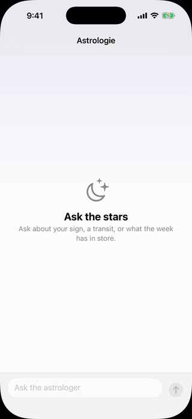
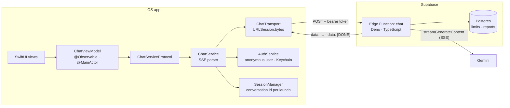

# Astrologie

An iOS chat app for Vedic astrology. Ask a question, and the reading streams in
as it's generated. SwiftUI and MVVM on the device; a Supabase Edge Function in
front of Gemini on the server.

<p align="center"></p>

**iOS 18+ · Swift · SwiftUI · Swift Concurrency · Swift Testing · Supabase · Deno · Gemini**

## Highlights

- **Streamed AI replies.** Server-Sent Events read with `URLSession.bytes`, parsed
  as the bytes arrive, and handed to the ViewModel as an `AsyncThrowingStream`. A
  reply only counts as complete when the `[DONE]` event arrives; anything shorter
  shows a "reply was cut off" error and keeps the partial text.
- **The AI sits behind a server.** The Gemini key, the system prompt and every
  guardrail live in the Edge Function. The model can be swapped with a server
  secret, without an app release.
- **Abuse and cost controls.** A per-user rate limit, a per-conversation turn
  limit and a report limit, stored in Postgres. If the limits can't be checked,
  the function refuses rather than calling Gemini.
- **Guardrails in code, not just in the prompt.** Explicit Gemini safety
  settings, a jailbreak denylist checked before the model is called, and a check
  on every streamed chunk.
- **Testable by design.** Protocol seams around every bit of I/O, so 250 iOS
  unit tests and 104 server tests run without a network.
- **One state value.** The chat screen is `idle`, `sending`, `streaming` or
  `failed`, never two at once. Haptics and VoiceOver announcements are derived
  from changes to that state.
- **Accessible.** VoiceOver announcements without re-reading a reply as it
  streams, Dynamic Type, and a "Report Message" action in the rotor.

## Architecture



- **MVVM with a protocol-based service layer.** The ViewModel depends on
  `ChatServiceProtocol` and never sees `URLSession`. Tests hand it a stub.
- **Concurrency.** The ViewModel is on the main actor; the service streams off
  it. Cancelling the stream cancels the network request.
- **Server.** The function checks the token, the input and the limits, then
  calls Gemini and relays the reply as it arrives. Errors come back as
  `{ "error": "…" }` with nothing internal in them.

## Key decisions

| Decision | Why |
|---|---|
| MVVM, not TCA or VIPER | One screen with no shared state. MVVM keeps the async flow testable without the overhead. Full record: [`architecture.md`](portfolio-weekly-executables/architecture.md) |
| iOS 18 minimum | One version behind current. Fewer OS versions to test |
| System Liquid Glass only | System bars get it on iOS 26. Custom surfaces use materials that also work on iOS 18 |
| A server in front of the AI | API keys can't be hidden in an app. Prompt, guardrails and model can change without a release |
| Gemini Flash, prompted | Cost, with a free tier. No private data to retrieve, so no RAG. The proxy means switching providers is a server change |
| Single-turn conversations | Conversation history is a security decision first. It stays out until it can live on the server, bounded |
| Limits in Postgres, failing closed | In-memory counters didn't survive across server instances. The rate limit is keyed on the user, not the client-chosen id |
| Anonymous sign-in | The server needs *a* user to rate-limit, not *who* |
| Markdown removed, not rendered | Half-finished markers flicker while streaming, and VoiceOver reads symbols aloud. The model's original text is kept |
| Topic gate deferred | A second model call per message doubles cost on the free tier. Logged in [`tech-debts.md`](portfolio-weekly-executables/tech-debts.md) |

## Project layout

```
Astrologie/                    Xcode project
  Astrologie/
    Models/                    Message model and API DTOs
    Services/                  Chat, auth and session services, errors, reporting
    ViewModels/                ChatViewModel, ChatState, ChatHaptic
    Views/                     Chat screen, bubbles, input bar, typing indicator
  AstrologieTests/             Swift Testing unit tests
  AstrologieUITests/           XCTest UI tests
supabase/
  functions/chat/              Edge Function: handler, limits, moderation, prompt
  migrations/                  Limit tables, reports, privileges, row expiry
portfolio-weekly-executables/  Plan, architecture record, tech-debt log
.kiro/specs/                   Task specs with "Done when" conditions
```

## Running it

**App.** Open `Astrologie/Astrologie.xcodeproj` in Xcode 26 and run the
`Astrologie` scheme on an iOS 18+ simulator. It talks to the deployed backend,
which runs on Gemini's free tier, so replies may stop for the day once the
quota is used up.

**Your own backend.** Create a Supabase project, apply the migrations, set the
`GEMINI_API_KEY` secret (and optionally `GEMINI_MODEL`), deploy the `chat`
function, and point `Astrologie/Astrologie/SupabaseConfig.swift` at your project.

## Tests

```bash
cd Astrologie && xcodebuild test -project Astrologie.xcodeproj -scheme Astrologie -destination 'platform=iOS Simulator,name=iPhone 17' -only-testing:AstrologieTests
```

```bash
cd supabase/functions/chat && deno task verify
```

250 iOS unit test cases and 104 Deno tests, all passing. `deno task verify` also
type-checks, lints and checks formatting. The UI test that streams a live reply
is skipped unless `TEST_RUNNER_ASTRO_LIVE=1` is set, because it spends Gemini
quota.

## How it was built

Ten weeks of short weekday sessions, each task written as a spec with a "Done
when" condition (`.kiro/specs/`). Debt found along the way went to a log that
gates any release (`tech-debts.md`) instead of derailing the plan.

The tasks were carried out by AI coding agents (AWS Kiro, then Claude Code),
with a human gate: the agent never commits, every change is reviewed before it's
committed, and production deploys need approval each time. Tool settings
enforce this, not just instructions.

## What's next

- A cooldown on rate limits and retry for a dropped stream
- A Stop button, and cancelling the stream when the app goes to the background
- Saving conversations with SwiftData
- Follow-up questions, with history stored on the server and capped
- A second feature, such as a birth chart, which is when a coordinator and
  feature modules come in

## Author

Pinky Salvanera, iOS engineer · [pinkysalvanera.com](https://www.pinkysalvanera.com)
